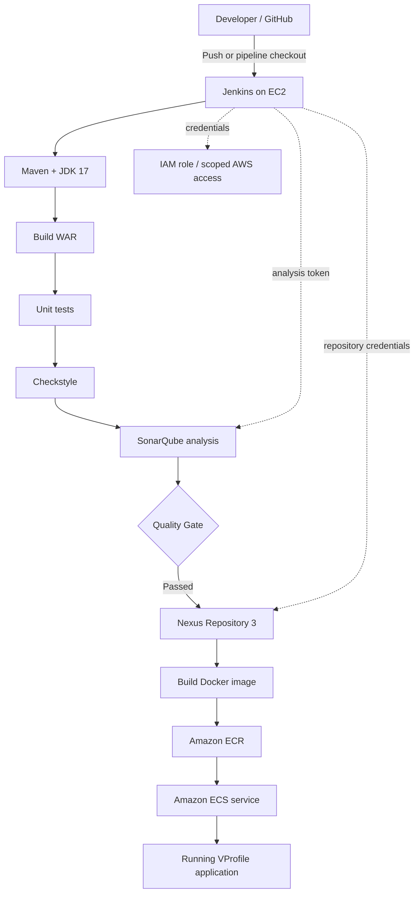

# VProfile Project --- Jenkins CI/CD on AWS (EC2 → ECR → ECS)

> **Project type:** End-to-end CI/CD pipeline\
> **Source repository:**
> [hkhcoder/vprofile-project](https://github.com/hkhcoder/vprofile-project)\
> **Source branch:** `docker`\
> **CI server:** Jenkins on Amazon EC2\
> **Build:** Maven + JDK 17\
> **Code quality:** SonarQube + Quality Gate + Checkstyle\
> **Artifact repository:** Nexus Repository 3\
> **Container registry:** Amazon ECR\
> **Deployment target:** Amazon ECS

This README documents the workflow and the Jenkins pipeline used to
build, test, analyze, package, publish, containerize, and deploy the
VProfile application.

## Contents

-   [Architecture](#architecture)
-   [CI/CD workflow](#cicd-workflow)
-   [Prerequisites](#prerequisites)
-   [AWS setup](#aws-setup)
-   [Jenkins setup](#jenkins-setup)
-   [SonarQube setup](#sonarqube-setup)
-   [Nexus setup](#nexus-setup)
-   [Pipeline walkthrough](#pipeline-walkthrough)
-   [Jenkins plugins and tools](#jenkins-plugins-and-tools)
-   [Credentials and security](#credentials-and-security)
-   [Important pipeline checks](#important-pipeline-checks)
-   [Troubleshooting](#troubleshooting)
-   [Cleanup](#cleanup)

## Architecture


The GIF above is an animated, perspective-style overview. GitHub README
rendering does not execute interactive 3D scenes; an animated GIF is a
portable way to show motion. The Mermaid diagram below provides a
readable, text-based architecture.



### High-level flow

1.  Jenkins checks out the `docker` branch from GitHub.
2.  Maven builds the application and produces a WAR artifact.
3.  Unit tests and Checkstyle analysis run.
4.  SonarQube analyzes the source code; Jenkins waits for the Quality
    Gate.
5.  The WAR is uploaded to Nexus.
6.  Jenkins builds a Docker image and pushes versioned and `latest` tags
    to ECR.
7.  Jenkins asks ECS to start a new deployment of the configured
    service.

> **Important:** `--force-new-deployment` asks ECS to redeploy the
> service. It does not itself change the task definition's image URI.
> The ECS task definition must reference the intended ECR image/tag. For
> predictable releases, update/register a task definition revision with
> an immutable image tag (for example, the Jenkins build number), then
> update the ECS service to that revision.

## CI/CD workflow

  -------------------------------------------------------------------------------------
  Stage                   What it does                      Expected result
  ----------------------- --------------------------------- ---------------------------
  Fetch code              Clones the `docker` branch        Workspace contains source
                                                            code

  Build                   `mvn clean install -DskipTests`   Compiled application and
                                                            WAR

  Unit test               `mvn test`                        Test results under
                                                            `target/surefire-reports`

  Checkstyle              `mvn checkstyle:checkstyle`       Style report, if configured
                                                            in the project

  Sonar analysis          Runs SonarScanner with project    Analysis submitted to
                          settings                          SonarQube

  Quality Gate            Waits for SonarQube's gate result Pipeline stops if gate
                                                            fails

  Publish to Nexus        Uploads WAR                       Versioned artifact in Nexus

  Build App Image         Builds Docker image               Local image tagged with
                                                            build number

  Upload App Image        Pushes image to ECR               Versioned and `latest` tags

  Deploy to ECS           Triggers ECS service deployment   ECS begins deployment
  -------------------------------------------------------------------------------------

## Prerequisites

-   An AWS account with permission to create EC2, IAM, ECR, ECS,
    networking, and logging resources.
-   A Jenkins controller on an EC2 instance. For production, use a
    separate build agent instead of running builds on the controller.
-   A SonarQube server reachable from Jenkins.
-   A Nexus Repository 3 server reachable from Jenkins.
-   An ECS cluster, service, task definition, and networking already
    configured for the application.
-   A Dockerfile and build context at `Docker-files/app/multistage/` in
    the checked-out repository.
-   GitHub access to the repository/branch.
-   DNS, security groups, and routing that allow the required services
    to communicate.

## AWS setup

### 1. Jenkins EC2 instance

Launch an EC2 instance and install a supported Java runtime for Jenkins.
Configure the instance security group to allow only the necessary
inbound traffic. Common examples:

-   SSH (`22`) restricted to your trusted IP or bastion.
-   Jenkins (`8080`) restricted to your IP/VPN, or preferably access
    Jenkins through a reverse proxy with TLS.
-   Do **not** expose SonarQube, Nexus, Docker, or database ports
    publicly without a specific need.

The exact OS package commands depend on the Linux distribution and the
Jenkins release. Follow the official Jenkins installation instructions
for your OS.

### 2. IAM access for Jenkins

**Preferred approach:** attach an EC2 instance profile/ IAM role to the
Jenkins EC2 instance. Grant only the permissions required for ECR image
push and ECS deployment. This avoids storing long-lived AWS access keys
in Jenkins.

If your learning setup requires an IAM user: 1. Create a dedicated IAM
user for CI/CD; do not use the AWS root account. 2. Prefer temporary
credentials or an instance role where possible. 3. If access keys are
necessary, create them securely, store them in Jenkins Credentials, and
rotate them. 4. Never commit access keys, secret keys, tokens, or `.env`
files to GitHub. 5. Scope policies to the specific ECR repository, ECS
cluster/service, and required actions.

ECR push commonly needs actions such as `ecr:GetAuthorizationToken`,
`ecr:BatchCheckLayerAvailability`, `ecr:InitiateLayerUpload`,
`ecr:UploadLayerPart`, `ecr:CompleteLayerUpload`, `ecr:PutImage`, and
related read actions. ECS deployment may require `ecs:UpdateService`
and, if the pipeline registers task definitions, the relevant
`ecs:RegisterTaskDefinition` and `iam:PassRole` permissions. Validate
the exact permissions against your deployment design.

### 3. ECR repository

Create an ECR repository named `vprofileappimg` in the same AWS region
as the pipeline configuration (`us-east-1` in the example). Copy the
repository URI from the AWS console and use that exact URI in Jenkins.

Example URI format:

``` text
<ACCOUNT_ID>.dkr.ecr.<REGION>.amazonaws.com/vprofileappimg
```

The account ID in the supplied pipeline is an example from that
configuration. Replace it with your own AWS account ID if needed.

### 4. ECS cluster and service

Create/configure: - ECS cluster: `vprofile` - ECS service:
`vproappservice` - Task definition with container image, CPU/memory,
port mappings, environment variables, logs, and task execution role. -
Networking and load balancer/target group if required by your
application. - A task execution role that can pull images from ECR and
write logs.

Make sure the ECS task definition points at the intended ECR repository.
For a release process, prefer an immutable image tag such as
`${BUILD_NUMBER}` rather than relying only on `latest`.

## Jenkins setup

### 1. Install Jenkins on EC2

Install Jenkins using the official instructions for the selected
operating system. Complete the initial unlock/setup wizard and create an
administrator account. Put Jenkins behind HTTPS and restrict access
before using it for real projects.

### 2. Configure global tools

In **Manage Jenkins → Tools** (menu labels can vary by Jenkins version),
configure:

-   **JDK:** name it exactly `JDK17` if the Jenkinsfile refers to
    `jdk "JDK17"`.
-   **Maven:** name it exactly `MAVEN3.9` if the Jenkinsfile refers to
    `maven "MAVEN3.9"`.
-   **SonarScanner:** configure a scanner installation named exactly
    `sonar8.0` if using `tool 'sonar8.0'`.

Tool names are case-sensitive and must match the pipeline.

### 3. Install relevant plugins

Install only plugins you need, and keep them updated. Common plugins for
this pipeline include:

  -----------------------------------------------------------------------
  Plugin                              Purpose
  ----------------------------------- -----------------------------------
  Pipeline                            Jenkinsfile-based pipelines

  Git                                 Checkout source from Git

  Maven Integration (optional)        Maven job integration and reporting

  JUnit                               Publish JUnit test results

  Docker Pipeline                     `docker.build` and
                                      `docker.withRegistry` pipeline
                                      steps

  Amazon ECR (if used by your setup)  ECR integration helpers; not
                                      required for every CLI-based setup

  Pipeline: AWS Steps                 `withAWS` step

  SonarQube Scanner for Jenkins       SonarScanner tool and SonarQube
                                      integration

  Nexus Artifact Uploader             Upload build artifacts to Nexus

  Credentials Binding                 Safely expose credentials to
                                      pipeline steps

  Workspace Cleanup (optional)        Clean workspaces

  Timestamper (optional)              Timestamped console output

  Build Timeout (optional)            Limit runaway builds
  -----------------------------------------------------------------------

Plugin names and compatibility vary by Jenkins version. Install from
**Manage Jenkins → Plugins**, then restart Jenkins if requested.

### 4. Configure credentials in Jenkins

Go to **Manage Jenkins → Credentials** and add credentials in the
appropriate store/scope.

  -----------------------------------------------------------------------
  Credential ID used in   Credential type         Purpose
  pipeline                                        
  ----------------------- ----------------------- -----------------------
  `awscreds`              AWS credentials, or use ECR push and ECS update
                          the EC2 instance role   

  `nexuslogin`            Username/password       Nexus upload

  SonarQube token         Secret text, configured Submit analysis
                          through SonarQube       
                          server settings         
  -----------------------------------------------------------------------

The example's `registryCredential = 'ecr:us-east-1:awscreds'` uses the
Docker Pipeline ECR credential syntax and references the Jenkins
credential ID `awscreds`. The `withAWS(credentials: 'awscreds', ...)`
step also references that ID. Ensure the installed plugin and credential
type match the syntax you use. With an EC2 instance role, configure the
AWS Steps plugin to use the role/default credential provider as
supported by your installed version instead of adding long-lived keys.

## SonarQube setup

1.  Launch SonarQube on an instance/container that Jenkins can reach.
2.  Configure its security group/firewall so only required hosts can
    connect.
3.  Sign in and create a project with key `vprofile` (or update the
    pipeline to match your project key).
4.  Create a user token for CI analysis.
5.  In Jenkins, configure **Manage Jenkins → System → SonarQube
    servers** with server name `sonarserver`, the server URL, and the
    token credential.
6.  Configure the SonarScanner tool installation named `sonar8.0`.
7.  Configure a webhook in SonarQube pointing to Jenkins' SonarQube
    webhook endpoint, commonly
    `https://<JENKINS_URL>/sonarqube-webhook/`. The `waitForQualityGate`
    step depends on the Jenkins/SonarQube integration and webhook.
8.  Verify that the project builds and that the Quality Gate status is
    reported back to Jenkins.

The pipeline uses `withSonarQubeEnv('sonarserver')`; the configured
server name must match exactly. Avoid putting the Sonar token directly
in the Jenkinsfile.

## Nexus setup

1.  Install and configure Nexus Repository 3.
2.  Create a repository compatible with the artifact type and deployment
    approach.
3.  Create a dedicated Nexus account with only upload permissions to the
    target repository.
4.  Store its username/password in Jenkins as `nexuslogin`.
5.  Update `nexusUrl`, `repository`, `groupId`, artifact filename, and
    versioning to match your environment.

The sample URL `172.31.21.185:8081` is a private IP and will work only
if Jenkins can route to that host in the same VPC/network (or through
connected networks). Replace it with your actual Nexus hostname/IP. Do
not expose Nexus publicly just to make the pipeline work.

## Pipeline walkthrough

### Build

``` bash
mvn clean install -DskipTests
```

This compiles and packages the project while skipping tests for this
phase. Tests are run separately in the following stage. The
`post { success { archiveArtifacts ... } }` block stores WAR files as
Jenkins build artifacts.

### Unit tests

``` bash
mvn test
```

This runs the tests configured in the Maven project. Consider adding
`junit ' **/target/surefire-reports/*.xml'` (without the leading space)
to publish test results in Jenkins' test report UI.

### Checkstyle

``` bash
mvn checkstyle:checkstyle
```

This goal generates a Checkstyle report when the project's Maven
configuration supports it. The exact output filename/path depends on the
Checkstyle plugin configuration. Confirm the report exists before
passing it to SonarQube.

### SonarQube and Quality Gate

The SonarScanner submits source and report information to SonarQube. The
Quality Gate stage waits for the webhook result and aborts the pipeline
when the gate fails. The report properties in the sample are
project/configuration-dependent; verify them against the versions of
SonarQube, SonarScanner, JaCoCo, Checkstyle, and Maven plugins you
actually use.

### Publish to Nexus

The uploader publishes `target/vprofile-v2.war`. Check that the actual
Maven build creates a file with exactly that name. `BUILD_TIMESTAMP` is
not guaranteed to exist unless a plugin or pipeline definition sets it;
define it explicitly or use a standard Jenkins build identifier for
versioning.

### Build and push the Docker image

The pipeline builds from `Docker-files/app/multistage/`, tags the image
with `BUILD_NUMBER`, then pushes both that tag and `latest` to ECR.
Ensure the Dockerfile's build context includes every file it needs and
that the final image is compatible with the ECS runtime architecture.

### Deploy to ECS

The sample runs:

``` bash
aws ecs update-service \
  --cluster "$cluster" \
  --service "$service" \
  --force-new-deployment
```

This triggers a new deployment using the task definition already
configured on the service. For a true build-once/deploy-that-image
workflow, update the ECS task definition to the newly pushed immutable
image tag before updating the service.

## Jenkins plugins and tools

Minimum pipeline-relevant setup:

-   Jenkins Pipeline
-   Git
-   Docker Pipeline
-   Pipeline: AWS Steps (for `withAWS`)
-   SonarQube Scanner for Jenkins
-   Nexus Artifact Uploader
-   Credentials Binding
-   JUnit (recommended for test reporting)

Tools configured in Jenkins: - Maven `MAVEN3.9` - JDK `JDK17` -
SonarScanner `sonar8.0`

Docker Engine/CLI and AWS CLI must also be available on the
machine/agent executing the relevant shell and Docker steps. A plugin
does not install the underlying Docker daemon or AWS CLI automatically.

## Credentials and security

-   Never hard-code AWS access keys, SonarQube tokens, Nexus passwords,
    or other secrets in the Jenkinsfile or repository.
-   Use an EC2 instance role where possible; otherwise use a dedicated
    IAM identity with least privilege and rotate keys.
-   Do not grant the Jenkins user unrestricted `sudo` just to run
    Docker.
-   Membership in the `docker` group is effectively root-equivalent on
    many Linux systems. Use an isolated build agent and understand the
    risk before adding `jenkins` to that group.
-   Restrict Jenkins, SonarQube, Nexus, and ECS management interfaces to
    trusted networks.
-   Enable TLS, backups, plugin updates, audit logging, and credential
    rotation.
-   Use immutable image tags and consider image scanning, signed images,
    and approval gates for production.

## Important pipeline checks

Before running this exact Jenkinsfile, verify these environment-specific
values:

-   `980088651931` --- AWS account ID in the ECR URI.
-   `us-east-1` --- AWS region.
-   `vprofileappimg` --- ECR repository.
-   `vprofile` --- ECS cluster.
-   `vproappservice` --- ECS service.
-   `sonarserver` --- Jenkins SonarQube server configuration name.
-   `sonar8.0` --- Jenkins SonarScanner tool name.
-   `MAVEN3.9` and `JDK17` --- Jenkins global tool names.
-   `172.31.21.185:8081` --- private Nexus address.
-   `vprofile-repo`, `QA`, `vproapp`, `target/vprofile-v2.war` --- Nexus
    repository and artifact coordinates.
-   `BUILD_TIMESTAMP` --- define this variable or change the version
    expression.
-   SonarQube report paths --- verify they match files generated by this
    project.
-   Docker build context --- confirm the Dockerfile exists at
    `Docker-files/app/multistage/`.

Also check that `mvn clean install -DskipTests` does not cause the
intended tests to be skipped in later stages due to project-specific
Maven settings. Running `mvn test` separately should execute tests
unless configured otherwise.

## Troubleshooting

  -----------------------------------------------------------------------
  Symptom                             Likely cause / action
  ----------------------------------- -----------------------------------
  `maven` or `jdk` tool not found     Tool name mismatch; check **Manage
                                      Jenkins → Tools**

  `docker: command not found`         Install Docker CLI/Engine on the
                                      actual agent executing the stage

  Permission denied on Docker socket  Check daemon state and group
                                      membership; reconnect the user
                                      session after group changes;
                                      consider a dedicated agent

  ECR login/push fails                Check region, repository URI, IAM
                                      permissions, credential ID/type,
                                      and network access

  `withAWS` not recognized            Install/configure Pipeline: AWS
                                      Steps and check
                                      credentials/provider setup

  Sonar quality gate waits forever    Verify webhook URL, Jenkins
                                      reachability, server name, token,
                                      and SonarQube integration

  Sonar report paths missing          Run build/report goals and confirm
                                      the files exist at the configured
                                      paths

  Nexus upload fails                  Check repository name, account
                                      permissions, URL reachability, WAR
                                      filename, and version

  ECS deploy does not run the new     Confirm the ECS task definition
  image                               references the new image tag;
                                      `--force-new-deployment` alone does
                                      not update the image URI

  ECS tasks fail health checks        Inspect ECS service events,
                                      container logs, port mappings,
                                      health checks, and security groups
  -----------------------------------------------------------------------


## Project status

This README describes the intended workflow from the supplied
Jenkinsfile. Validate all names, plugin versions, report paths, AWS
permissions, artifact names, and deployment behavior in your own
environment before using it for production.

------------------------------------------------------------------------

